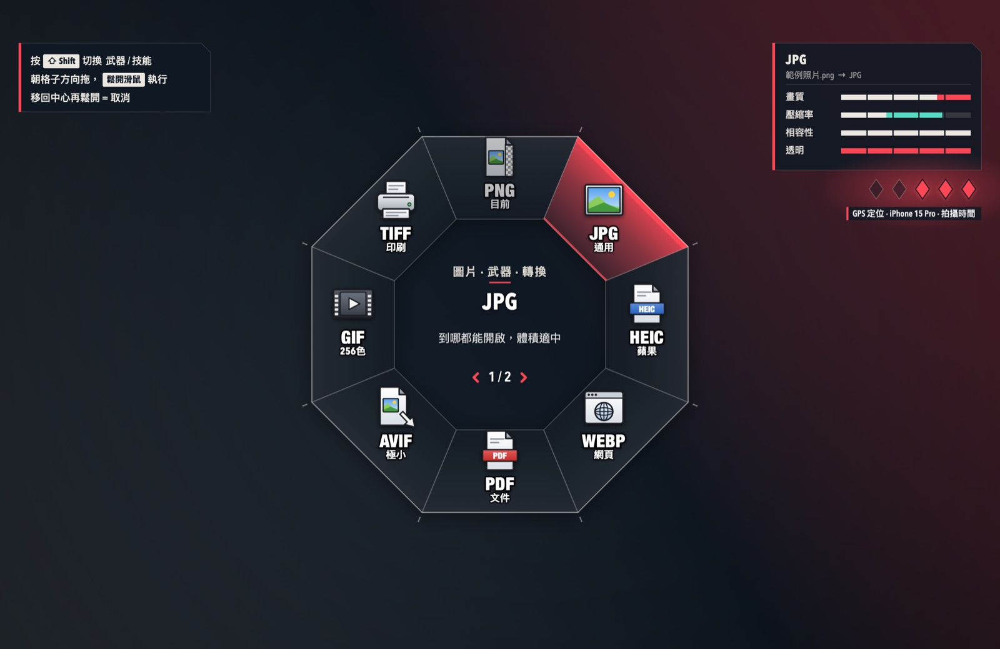
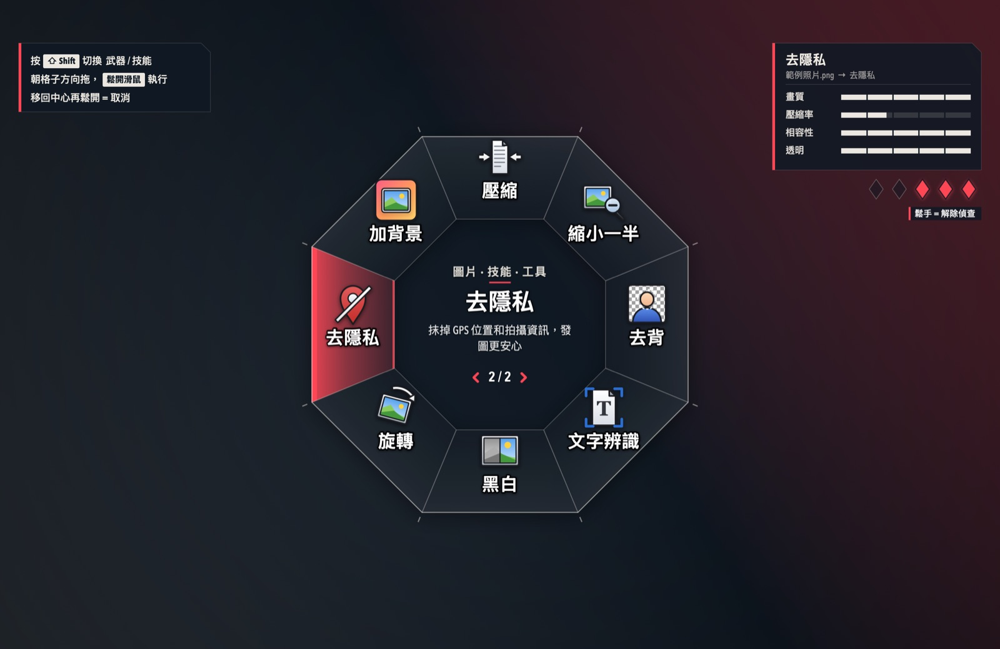
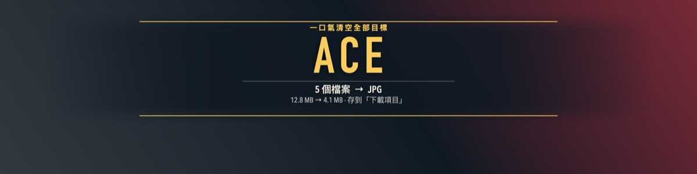
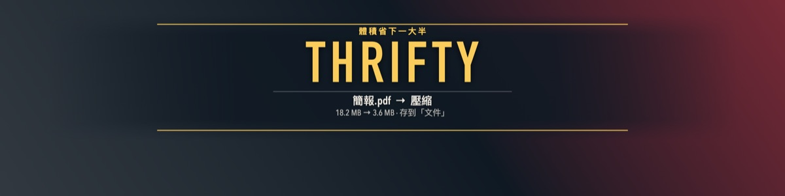
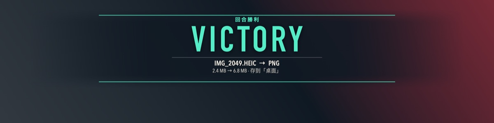
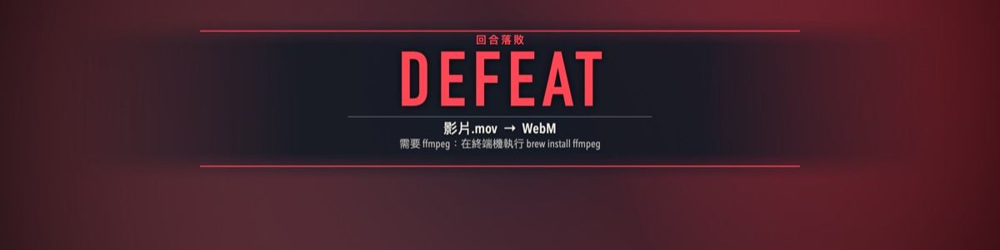

<h1 align="center">AgentWheel</h1>

<p align="center">
  <b>拖著檔案按一下 ⇧ Shift，像在購買階段挑槍一樣挑格式。</b><br>
  一個住在 macOS 選單列（Windows 通知區域）的格式轉換工具，介面用特戰英豪的 HUD 風格重新設計。
</p>

<p align="center">
  <a href="https://github.com/xaaaavier429/AgentWheel/releases/latest/download/AgentWheel.dmg"></a>
  <a href="https://github.com/xaaaavier429/AgentWheel/releases/latest/download/AgentWheel-Windows-x64.zip"></a>
</p>

<p align="center">macOS 14 以上 · Windows 10 / 11（64 位元）· 完全離線</p>

<p align="center"></p>

---

轉個檔通常要開 App、選檔案、找選單、按匯出。特戰輪盤把這些縮成一個動作：檔案拖到一半按 Shift，輪盤就在游標底下展開，往想要的格式一甩、放開滑鼠，轉好的檔案會出現在原檔旁邊。

它能處理圖片、PDF、影片、音訊和文件，共 70 多種轉換和小工具，全部在你自己的電腦上完成，不會上傳任何東西。

> 用 Windows 的話直接跳到 **[Windows 版](#windows-版)**，下面的安裝和更新步驟是 Mac 用的。

## 安裝

1. 下載 **[AgentWheel.dmg](https://github.com/xaaaavier429/AgentWheel/releases/latest/download/AgentWheel.dmg)**，打開後把 AgentWheel 拖進「應用程式」。
2. 打開「應用程式」裡的**特戰輪盤**（英文系統顯示為 AgentWheel）。選單列會多一個八角形的小圖示，第一次啟動會自動示範一次。
3. 安裝完可以把 DMG 退出：在桌面或 Finder 側邊欄對「特戰輪盤」磁碟按右鍵 →「退出」。

> 它是選單列 App，打開後 **Dock 不會出現圖示**，要找螢幕右上角的八角形小圖示。看不到的話，可能是選單列圖示太多被瀏海擋住了，可以按住 ⌘ 把其他圖示拖走騰出位置。

<details>
<summary>macOS 說「無法驗證開發者」打不開？</summary>

這個 App 沒有向蘋果付費做公證，所以第一次會被擋下，放行一次之後就不會再問：

- **macOS 14**：在「應用程式」裡對 AgentWheel 按右鍵 →「打開」→ 再按一次「打開」。
- **macOS 15 以後**：先雙擊一次讓它被擋，接著到「系統設定 → 隱私權與安全性」，往下找到 AgentWheel 按「強制打開」。
- 還是不行的話，在「終端機」執行下面這行，再重新打開：

  ```bash
  xattr -dr com.apple.quarantine /Applications/AgentWheel.app
  ```

</details>

## 開機自動執行

想要每次開機都不用手動打開，有兩種設定方式，選一種就好：

**方法一：在 App 裡打開（推薦）**

1. 點選單列右上角的八角形圖示。
2. 勾選「**登入時自動啟動**」。

之後每次登入 Mac 就會自動在背景執行。想取消就再點一次，把勾勾拿掉。

**方法二：在系統設定加入**

1. 打開「**系統設定 → 一般 → 登入項目與延伸功能**」（舊版 macOS 叫「登入項目」）。
2. 在「登入時打開」下方按「**＋**」，選「應用程式」裡的特戰輪盤，按「打開」。

想取消的話，在同一個清單選取特戰輪盤，按「**−**」移除。

> 兩種方法的效果一樣，不用兩個都設定。重開機後選單列有出現八角形圖示，就代表設定成功。

## 更新到新版本

新版本會發布在 [Releases](https://github.com/xaaaavier429/AgentWheel/releases) 頁面。更新時要**先關掉正在執行的舊版**，不然 macOS 會跳出「項目 AgentWheel 正在使用中」而無法取代。

**步驟**

1. **關掉舊版**：點選單列的八角形圖示 → 最下面的「**結束特戰輪盤**」（或在選單打開時按 ⌘Q）。
2. **下載新版**：下載最新的 **[AgentWheel.dmg](https://github.com/xaaaavier429/AgentWheel/releases/latest/download/AgentWheel.dmg)** 並打開。
3. **取代舊版**：把 AgentWheel 拖進「應用程式」，跳出「已經有同名項目」時選「**取代**」。
4. **打開新版**：到「應用程式」打開特戰輪盤。如果又出現「無法驗證開發者」，照[安裝](#安裝)裡的方式放行一次。
5. **收尾**：把 DMG 退出，下載的 DMG 檔可以丟進垃圾桶。

你的設定（配色、輪盤大小、音效開關、開機自動執行、自訂音效）都會保留，不用重新設定。

<details>
<summary>選單列找不到圖示，但還是顯示「正在使用中」？</summary>

可能是舊版還在背景執行但圖示被擋住了。用下面任一種方式強制關掉，再回到第 3 步：

- 打開「**活動監視器**」（應用程式 → 工具程式），搜尋 `AgentWheel`，選取後按上方的「⊗」→「結束」。
- 或在「終端機」執行：

  ```bash
  pkill -x AgentWheel
  ```

</details>

<details>
<summary>怎麼確認自己裝的是哪個版本？</summary>

在「應用程式」裡對特戰輪盤按右鍵 →「**取得資訊**」，「版本」那一欄就是目前的版本號，可以跟 [Releases](https://github.com/xaaaavier429/AgentWheel/releases) 頁面上最新的版本比對。

</details>

<details>
<summary>想完全移除</summary>

1. 點選單列圖示，先把「登入時自動啟動」的勾勾拿掉，再按「結束特戰輪盤」。
2. 把「應用程式」裡的特戰輪盤丟進垃圾桶。
3. （可選）自訂音效放在 `~/Library/Application Support/AgentWheel/`，不需要的話一起刪掉。

</details>

## Windows 版

Windows 版是用 C# 重新寫的，輪盤、音效、結算畫面和所有轉換功能都跟 Mac 版一樣。

### 安裝

1. 下載 **[AgentWheel-Windows-x64.zip](https://github.com/xaaaavier429/AgentWheel/releases/latest/download/AgentWheel-Windows-x64.zip)**。
2. 對壓縮檔按右鍵 →「**解壓縮全部**」，把資料夾放到固定的位置，例如「文件\AgentWheel」。不要直接在壓縮檔裡面執行。
3. 雙擊資料夾裡的 **AgentWheel.exe**。右下角通知區域會多一個八角形圖示，第一次啟動會自動示範一次。

> Windows 11 的通知區域圖示常常被收進「**^**」裡。把八角形圖示拖到工作列上，之後就會一直顯示。

<details>
<summary>跳出「Windows 已保護您的電腦」？</summary>

這個程式沒有買程式碼簽章憑證，所以 SmartScreen 第一次會擋。按「**其他資訊**」→「**仍要執行**」就好，之後不會再問。

</details>

資料夾裡除了主程式，還附了影片／音訊轉檔要用的 `ffmpeg.exe`、`ffprobe.exe`，以及去背用的模型 `models\u2netp.onnx`，不用另外安裝。

### 開機自動執行

點通知區域的八角形圖示，勾選「**登入時自動啟動**」。之後每次登入 Windows 就會在背景執行，再點一次就能取消。

> 如果之後把資料夾搬到別的地方，記得取消再重新勾一次，讓它記住新的位置。

### 更新到新版本

1. **關掉舊版**：點通知區域的八角形圖示 → 最下面的「**結束特戰輪盤**」。
2. **下載新版**：下載最新的 [AgentWheel-Windows-x64.zip](https://github.com/xaaaavier429/AgentWheel/releases/latest/download/AgentWheel-Windows-x64.zip) 並解壓縮。
3. **取代舊版**：把新資料夾裡的檔案全部複製到舊資料夾，跳出「取代或略過檔案」時選「**取代目的地中的檔案**」。
4. **打開新版**：雙擊 AgentWheel.exe。

配色、輪盤大小、音效、自訂音效和開機自動執行都會保留。

<details>
<summary>複製時說「檔案正在使用中」？</summary>

舊版還在背景執行。按 Ctrl + Shift + Esc 打開「**工作管理員**」，在「處理程序」裡找到 AgentWheel，按右鍵 →「**結束工作**」，再重新複製一次。

</details>

<details>
<summary>想完全移除</summary>

1. 點通知區域圖示，先把「登入時自動啟動」的勾勾拿掉，再按「結束特戰輪盤」。
2. 刪掉整個 AgentWheel 資料夾。
3. （可選）設定和自訂音效在 `%APPDATA%\AgentWheel`，紀錄檔在 `%LOCALAPPDATA%\AgentWheel`，在檔案總管的網址列貼上這兩個路徑就能找到，不需要的話一起刪掉。

</details>

### 跟 Mac 版不一樣的地方

- 輪盤是從**檔案總管**或桌面拖檔案時按 Shift 叫出來，結果一樣存在原檔旁邊（原檔所在的資料夾不能寫入時，會改存到「下載」）。
- 圖片轉檔、壓縮、去背都內建在程式裡，不需要 `cwebp`。文字辨識用的是 Windows 內建的 OCR，要先在「**設定 → 時間與語言 → 語言**」裡裝好中文。
- 文件轉 PDF、舊版 `.doc`：電腦有裝 **Word** 或免費的 **[LibreOffice](https://zh-tw.libreoffice.org/)** 時會交給它們處理，排版最完整。都沒裝的話，PDF 會用 Windows 內建的「Microsoft Print to PDF」輸出，`.doc` 的格子則會顯示「未裝備」。
- 沒有「背景虛化」選項，輪盤後面固定是半透明的深色遮罩。
- 解壓縮後如果把 `ffmpeg.exe` 刪掉了，影音的格子會變成「未裝備」，可以從圖示選單的「**安裝 ffmpeg…**」用 winget 裝回來。

## 使用方式

| 動作 | 怎麼做 |
| --- | --- |
| 叫出輪盤 | 在 Finder（Windows 是檔案總管）拖住檔案（可以多選），**還沒放開**時按一下 ⇧ Shift |
| 選格式 | 往格子的**方向**移動就好，不用真的拖到格子上 |
| 執行 | 放開滑鼠，結果存在原檔旁邊，原檔不會被動到 |
| 換頁 | 再按一次 Shift，在「武器（格式轉換）」和「技能（工具）」之間切換 |
| 取消 | 移回中間再放開，或按 Esc |
| 不想拖曳 | 選單列（通知區域）圖示 →「選擇檔案開啟輪盤…」，用點的 |

<p align="center"></p>

## 輪盤裡有什麼

輪盤會依照你拖進來的檔案類型換成對應的格子：

| 檔案 | 武器頁（格式轉換） | 技能頁（工具） |
| --- | --- | --- |
| 圖片 | PNG · JPG · HEIC · WebP · PDF · AVIF · GIF · TIFF | 壓縮 · 縮小一半 · 去背 · 文字辨識 · 黑白 · 旋轉 · 去隱私 · 加背景 |
| PDF | PNG · JPG · 長圖 · Word · TXT · Markdown · RTF · HTML | 壓縮 · 拆頁 · 合併 · 旋轉 · 黑白 · 文字辨識 · 去隱私 · ZIP |
| 影片 | MP4 · MOV · HEVC · WebM · GIF · MP3 · M4A · WAV | 壓縮 · 靜音 · 720P · 擷取封面 · 2 倍速 · 慢動作 · 去隱私 · ZIP |
| 音訊 | MP3 · M4A · WAV · FLAC · AIFF · Opus · ALAC · iPhone 鈴聲 | 壓縮 · 單聲道 · 音量統一 · 1.5 倍速 · ZIP · 複製路徑 |
| 文件 | PDF · Word · TXT · Markdown · HTML · RTF · ODT · DOC | 字數統計 · 複製全文 · 去隱私 · ZIP · 複製路徑 |
| 其他 | ZIP · 複製路徑 · 複製檔名 · SHA-256 | |

多張圖片一起丟進 PDF 格，會合成一份 PDF。右上角的數值條會比較轉換前後：白色是保留的、青色是變好的、紅色是犧牲掉的。

Mac 版有幾個格式需要額外的工具：WebP 要 `cwebp`，AVIF、WebM、MP3、Opus 和影音變速要 `ffmpeg`。沒裝的格子會顯示「未裝備」，用 Homebrew 一行補齊（Windows 版已經附在壓縮檔裡）：

```bash
brew install ffmpeg webp
```

## 回合結算

每次轉完都會跳一張結算畫面，依結果換字：

| | 條件 |
| --- | --- |
| **ACE** | 一次處理 5 個以上的檔案 |
| **THRIFTY** | 轉出來的檔案不到原本的一半大 |
| **FLAWLESS** | 用「去隱私」清掉了檔案裡的追蹤資訊 |
| **VICTORY** | 其他順利完成的情況 |
| **DEFEAT** | 失敗了，下面會寫原因和解法 |

<p align="center">
  
  
  
  
</p>

## 偵查標記

照片和文件常常偷偷帶著你的資訊：GPS 位置、手機型號、拍攝時間、PDF 或 Word 的作者名字。輪盤打開時會先掃一遍，右上角亮起幾顆紅色菱形，就代表找到幾項線索。

把游標指向「去隱私」，菱形會開始閃；放開就會清掉這些資訊（不會重新壓縮畫面），結算畫面顯示 FLAWLESS。

## 個人化

全部都在選單列（Windows 是通知區域）的圖示裡：

- **角色配色**、**輪盤大小**、**音效**、**背景虛化**（僅 Mac）、**結算畫面**、**登入時自動啟動**
- **自訂音效資料夾**：內建音效都是程式即時合成的。想換成自己的聲音，把 `passed.wav`、`ace.wav`、`wasted.wav` 這類檔案丟進去就會取代，資料夾裡的「說明.txt」列了所有檔名

## 開發

只需要 Xcode Command Line Tools（`xcode-select --install`），不用裝完整的 Xcode。

```bash
git clone https://github.com/xaaaavier429/AgentWheel.git
cd AgentWheel
./build.sh       # 編譯成 build/AgentWheel.app
./package.sh     # 打包成 dist/AgentWheel.dmg（Apple 晶片 + Intel 通用）
```

**Windows 版**放在 `windows/` 資料夾，用 C#（.NET 8 + WPF）寫成。在 Windows 上裝好 [.NET 8 SDK](https://dotnet.microsoft.com/download/dotnet/8.0)（或 `winget install Microsoft.DotNet.SDK.8`）之後：

```powershell
cd AgentWheel\windows
.\build.ps1     # 輸出到 windows\publish\AgentWheel.exe
```

推到 GitHub 時，`.github/workflows/windows.yml` 會自動在雲端編譯，並把 ffmpeg 和去背模型一起打包成 `AgentWheel-Windows-x64.zip`（在 Actions 頁面的 Artifacts 下載）。推一個 `v` 開頭的 tag，壓縮檔就會自動附加到 Release。

<details>
<summary>測試用的命令列參數</summary>

`B=build/AgentWheel.app/Contents/MacOS/AgentWheel`

| 指令 | 用途 |
| --- | --- |
| `$B --snapshot 圖.png --files 照片.jpg --hover 0 --wanted 3` | 不用真的拖檔案，直接輸出輪盤畫面 |
| `$B --banner 圖.png --word ace` | 輸出結算畫面（`victory` / `thrifty` / `flawless`，加 `--wasted` 是 DEFEAT） |
| `$B --icon 圖.png --px 512` | 輸出 App 圖示 |
| `$B --sounds 資料夾` | 把內建音效匯出成 WAV |
| `$B --ids` / `$B --run img.to.png 照片.heic` | 列出所有動作 / 直接執行一個 |

Windows 版的參數一樣，把 `$B` 換成 `AgentWheel.exe` 即可（`--icon` 除外）。

</details>

## 致謝與授權

這個專案改編自 [Elise616/FormatWheel](https://github.com/Elise616/FormatWheel)。拖曳加 Shift 叫出輪盤的操作，還有整套轉換功能都來自原作；我把介面、音效、結算畫面和偵查系統改成特戰英豪風格，並把文字換成繁體中文。原作與本專案都以 [MIT](LICENSE) 授權釋出。

特戰輪盤是粉絲自製的非官方作品，與 Riot Games 沒有任何關係。介面裡的圖示和音效全部用程式碼繪製、合成，沒有使用任何遊戲素材。
